# STM32H750 智能家居终端

> 一块 **STM32H750**（Cortex-M7 @ 480 MHz）上从零构建的**智能家居控制终端**：
> **裸机 + FreeRTOS + LVGL 9.5** 驱动 **800×480 LTDC 双层显示**，代码跑 **QSPI XIP**、帧缓冲在 **SDRAM**；
> 带 **QSPI 双槽 bootloader + 整机 OTA**（云端触发 → ESP32-C6 下载 → STM32 落盘 → 校验切槽）、
> **ESP32-C6 协处理器桥接**、**统一 VFS**（FatFS 的 SD + littlefs 的 SPI Flash）与 **POSIX 系统调用层**。

<p align="center">
  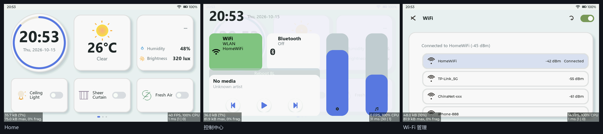
</p>

<p align="center">
  
  
  
  
  
  
</p>

> **说明**：本仓库是**工程展示站**（架构 / 界面 / 硬件 / 关键数据 / 设计取舍）。
> **完整源码、Bootloader 子仓与 PC 侧工具链目前为私有**，可按需提供或做技术答疑。

---

## 目录

- [1. 它是什么](#1-它是什么)
- [2. 硬件](#2-硬件)
- [3. 系统架构](#3-系统架构)
- [4. 界面与真机演示](#4-界面与真机演示)
- [5. 技术亮点](#5-技术亮点)
- [6. 关键数据](#6-关键数据)
- [7. OTA 链路（最有代表性的一条）](#7-ota-链路最有代表性的一条)
- [8. 工程化与验证](#8-工程化与验证)
- [9. 开发时间线](#9-开发时间线)
- [10. 仓库导航](#10-仓库导航)
- [11. 许可与第三方](#11-许可与第三方)

---

## 1. 它是什么

一个**真正装机跑起来的**嵌入式智能终端，不是 demo 拼图。它把下面这些凑成了一个能用的整体：

| 能力 | 落地形态 |
|---|---|
| **图形界面** | LVGL 9.5，多屏幕（Home / 控制中心 / WiFi 管理 / 设置…），主题系统、i18n、手势（下拉控制中心、上滑返回） |
| **实时数据显示** | I2C 传感器（SHT3x 温湿度 / BH1750 光照 / AT24Cxx EEPROM）+ RTC 走字 |
| **设备控制** | 实体模型（MVVM）+ 事件总线；命令码契约 v1.1；MQTT 过滤器/差分更新 |
| **联网** | ESP32-C6 协处理器（WiFi/MQTT/TLS 全交给它），自定义 UART 帧协议 `AA55\|type\|len\|payload\|CRC16` |
| **存储** | 统一 VFS：`U:` = FatFs（SD 卡）+ `S:` = littlefs（SPI Flash）；上层还有 POSIX/newlib 系统调用 |
| **升级** | QSPI 双槽 bootloader + 云端 MQTT 触发 + HTTP Range 下载 + staging 校验 + 切槽，失败自动回跳 |

---

## 2. 硬件

| 部件 | 型号 / 规格 | 说明 |
|---|---|---|
| 主控 | **STM32H750XBH6**（Cortex-M7 @ 480 MHz，**TFBGA240** 封装，128 KB 片内 Flash） | 代码放外部 QSPI（XIP），片内只留启动；型号取自 `boot.ioc` 的 `Mcu.CPN` |
| 外部 Flash | **W25Q256**（32 MB，QSPI） | App 双槽：slot A / slot B |
| SPI Flash | **W25Q128 / W25Q64**（SPI1） | `S:` 小文件系统 + OTA staging（容量无关布局） |
| SDRAM | 32 MB（FMC） | 帧缓冲 / 媒体缓冲 / 大块数据 |
| 显示 | **800×480 RGB LCD**（LTDC，双层） | L1 底层 + L2 = LVGL UI；三缓冲 + 垂直消隐换页 |
| 触摸 | **GT1158**（I2C2 + TIM7 定时 + DMA 后台采样） | 不阻塞 GUI 任务；带总线卡死自愈 |
| 传感器 | SHT3x、BH1750、AT24Cxx（I2C） | 温湿度 / 光照 / 参数存储 |
| 协处理器 | **ESP32-C6**（N16 最小系统板） | WiFi6/BLE/MQTT/TLS，USART6 921600 桥接 |
| 其他 | 背光 PWM（TIM12）、RTC（LSE）、SD 卡（SDMMC1） | — |

<p align="center">
  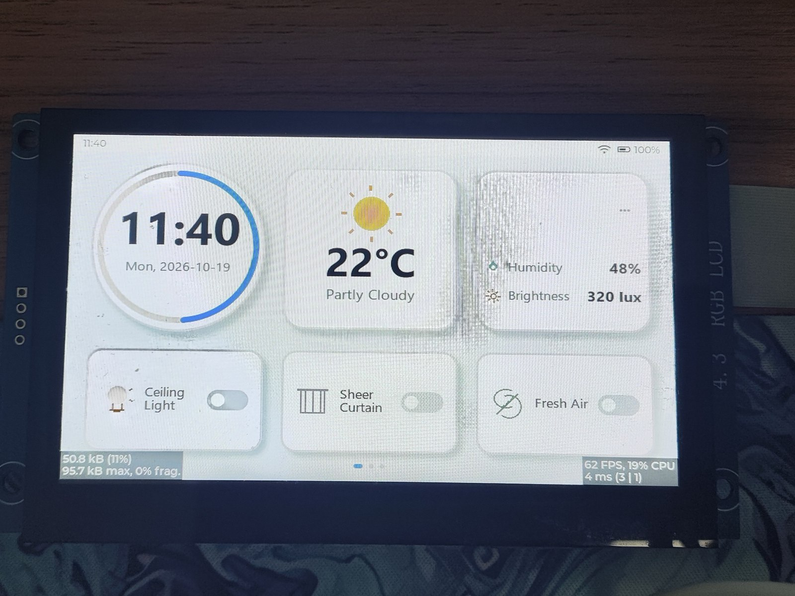
</p>

<p align="center">
  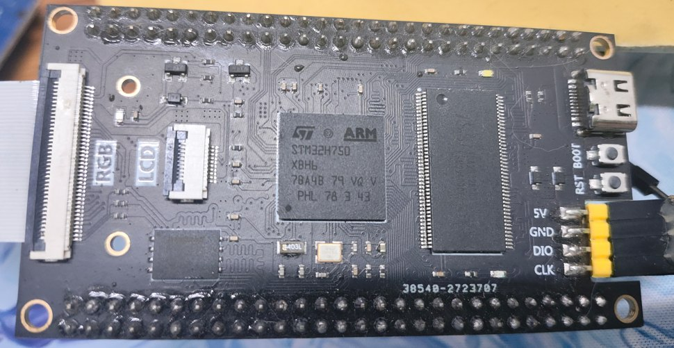
  &nbsp;
  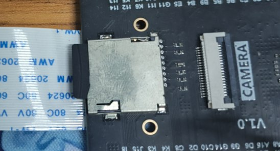
</p>

<p align="center">
  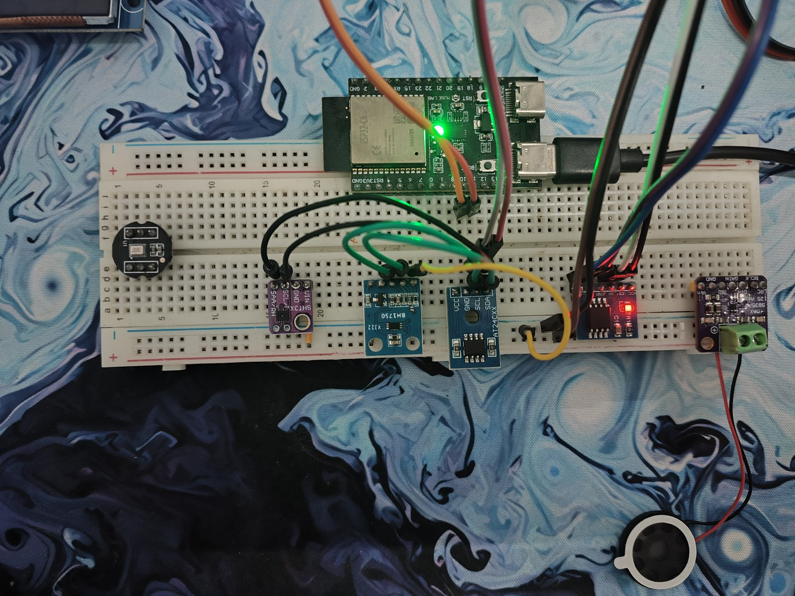
</p>

---

## 3. 系统架构

<p align="center">
  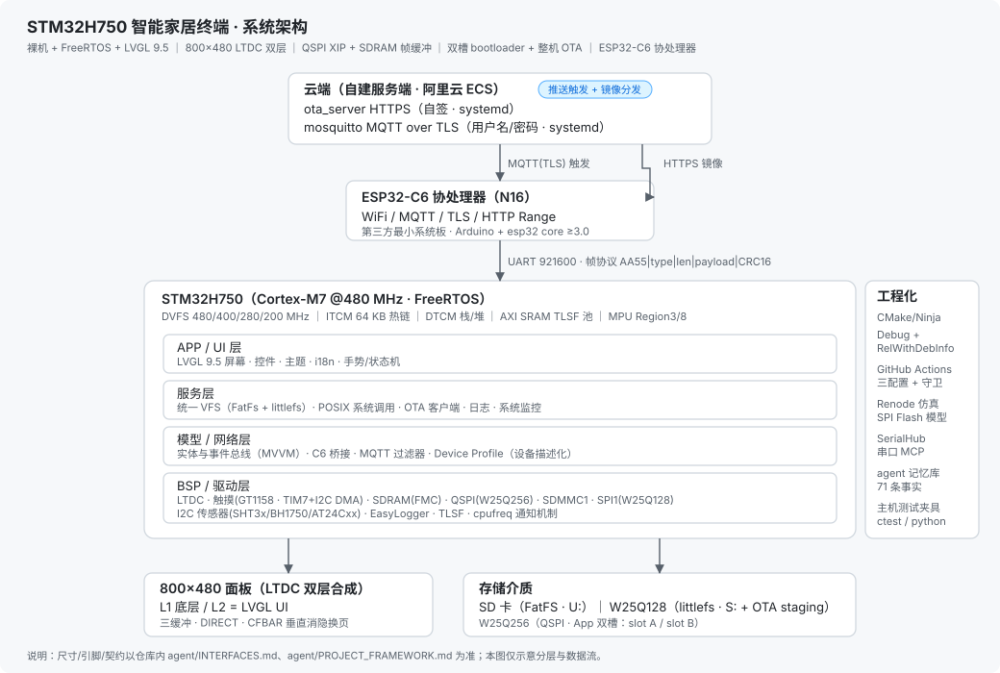
</p>

分层要点（细节见 [`docs/architecture.md`](docs/architecture.md)）：

- **内存层级是设计的核心**：ITCM 放高频 ISR 与渲染热链、DTCM 放任务栈与 RTOS 堆、AXI SRAM 由 TLSF 接管堆、SDRAM 放帧缓冲 —— 这不是堆砌，是**每一层都用测出来的数据定过**。
- **DMA 与缓存有明确契约**：凡 DMA 目标一律不进可缓存区（D2 用 MPU 非缓存、AXI 用专段），否则就要逐点 clean/invalidate，容易漏。
- **显示路径**：LVGL `DIRECT` 模式 + 三缓冲 + **CFBAR 影子寄存器在垂直消隐期换页**，并做"下一块是否正被扫描"的**异步门控**，慢场景不掉帧。

---

## 4. 界面与真机演示

### 4.1 真机实拍（2026-11-13）

<p align="center">
  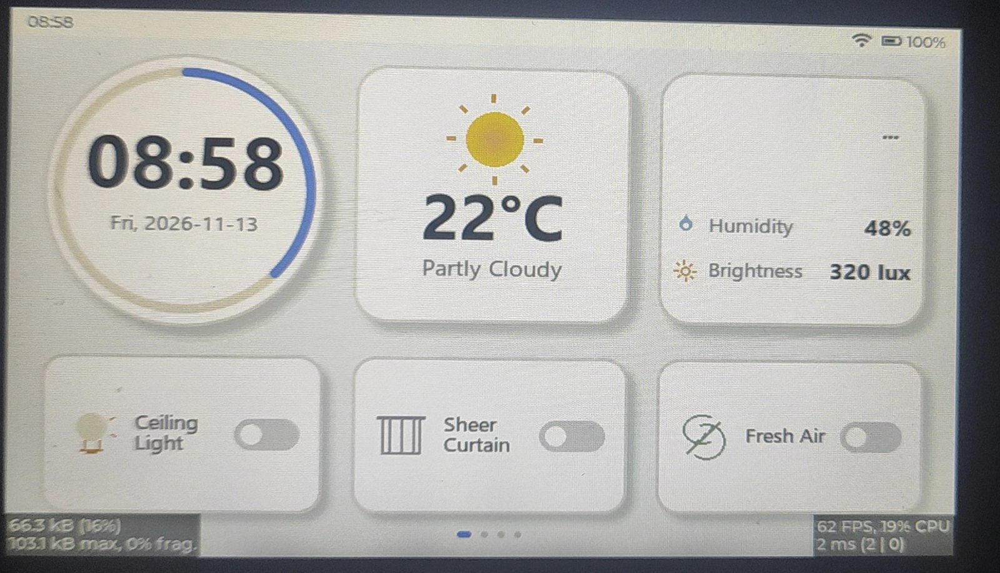
  &nbsp;
  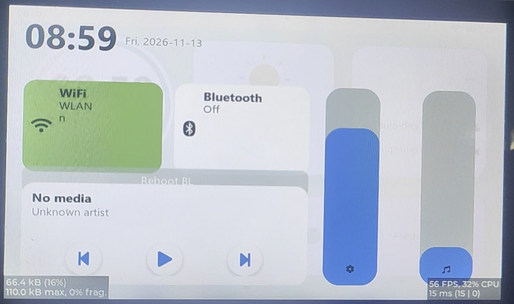
</p>

屏幕左下角是 **LVGL 内存监视器**（`663.3 KB / 1031 KB max / 0% frag`），
右下角是**帧率 / CPU / 帧耗时计数器**，两个页面读数分别是 **`62 FPS, 19% CPU, 2 ms`** 与
**`56 FPS, 32% CPU, 15 ms`** —— 与 [§6 关键数据](#6-关键数据) 里的优化结论一致。
（左侧 Home 页还带着**真实传感器读数**：温湿度 48%、光照 320 lux。）

### 4.2 手势演示（约 5 秒）

点下面的图播放完整视频（`images/demo-gesture.mp4`，620 KB）；下面是自动播放的 GIF。

<p align="center">
  <a href="images/demo-gesture.mp4">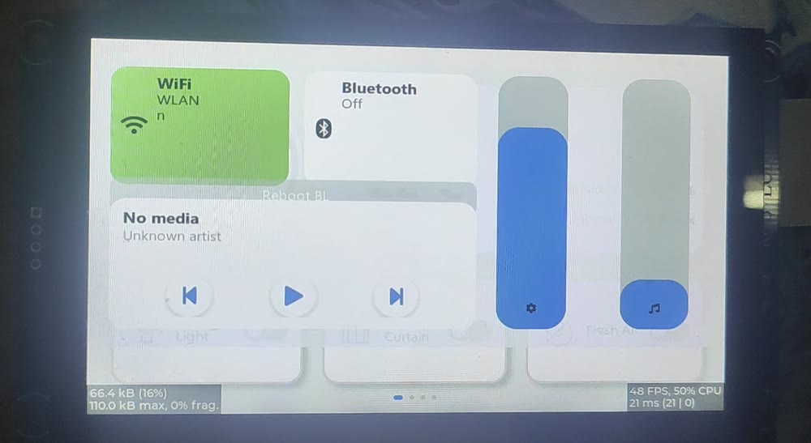</a>
</p>

<p align="center">
  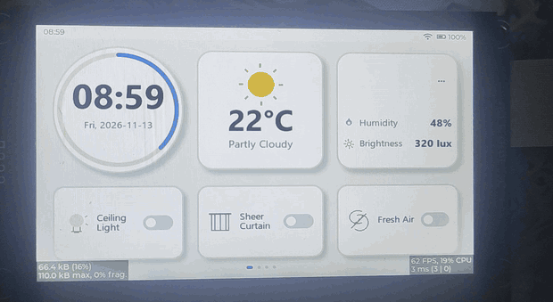
</p>

> 演示内容：Home → **下拉控制中心**（WiFi/蓝牙/媒体/亮度音量滑杆）→ 上滑返回。
> 录制为手持实拍，因此有轻微抖动与拍屏条纹。

### 4.3 仿真渲染帧（800×480 原始分辨率）

<p align="center">
  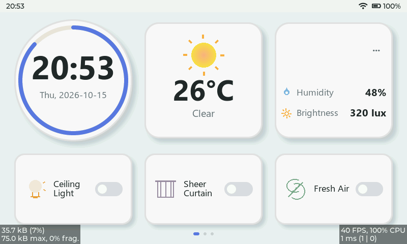
  &nbsp;
  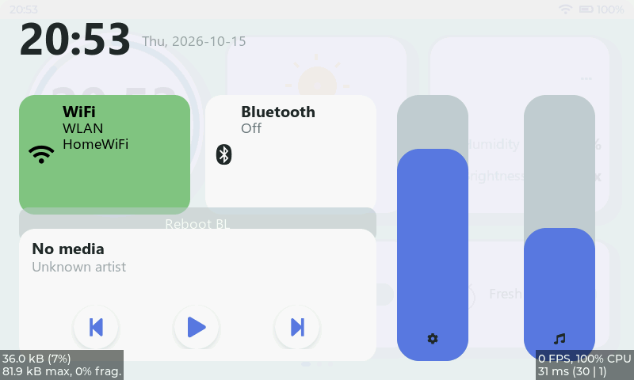
  &nbsp;
  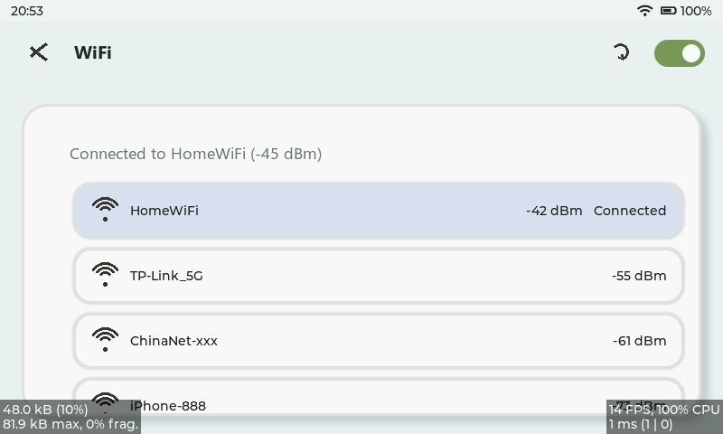
</p>

> 这三张是 **Renode FrameDump 导出的渲染帧**（800×480，与真机同一套代码路径），
> 优点是**无拍屏条纹、能看清 UI 细节**，适合放在文档里对照；真机观感见 §4.1。

启动日志（Bootloader → APP 跳转）：

<p align="center">
  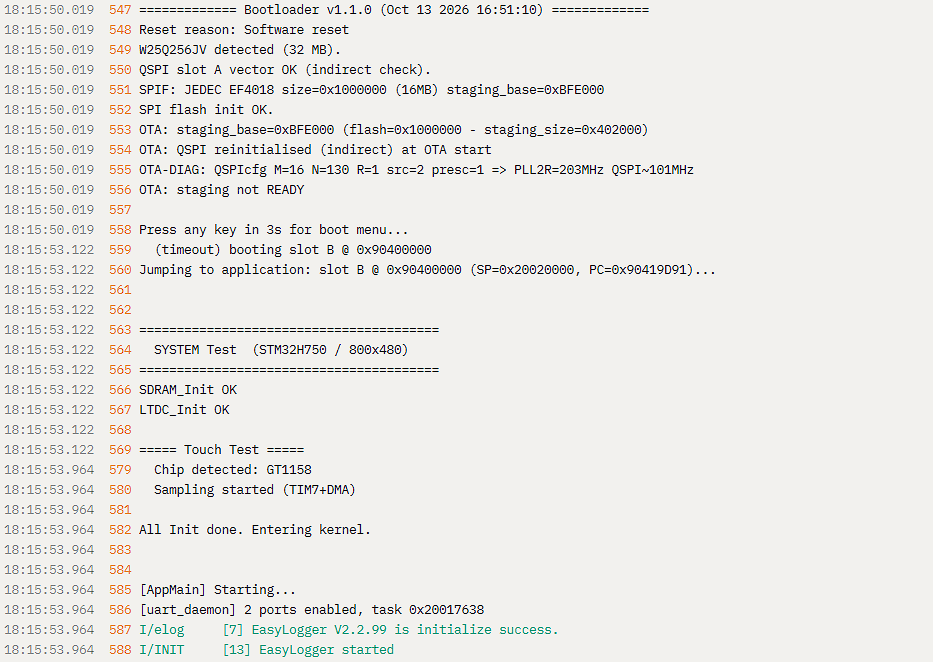
</p>

---

## 5. 技术亮点

### 5.1 LVGL 渲染：平均 **42 → 52 fps**，帧耗时 **21 → 11 ms**

<p align="center">
  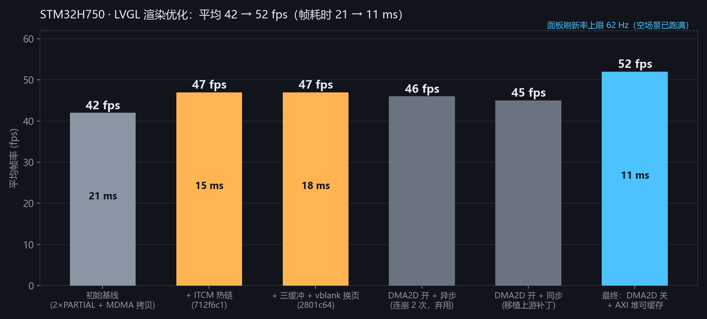
</p>

不是"加了几块缓冲"那么简单，每一步都对应一个具体判断：

| 步骤 | 做法 | 结果 |
|---|---|---|
| 换掉上屏方式 | 三缓冲 + `DIRECT` + CFBAR 垂直消隐换页，**删掉每帧 MDMA 全屏拷贝** | Empty screen 的 flush **≈12 ms → 0 ms**（46 → 62 fps，跑满面板） |
| 加异步门控 | 只有"下一块正被扫描"才等 vblank，否则立即放行 | 慢场景（渲染 > 帧周期）**不再被刷新率锁死** |
| 把 CPU 抢回来 | 高频 ISR 与渲染热链进 **ITCM**；触摸改 **TIM7 + DMA 后台采样** | 帧耗时 **−29%**；GUI 任务 CPU **62% → 48%** |
| 关掉一个"加速器" | **DMA2D** 判别实验后**整体弃用** | 帧率不变，但显示损坏/崩溃消失；后续把 AXI 堆改可缓存 ⇒ **52 fps** |

### 5.2 一个反直觉的结论：**DMA2D 在这块板子上是负收益**

<p align="center">
  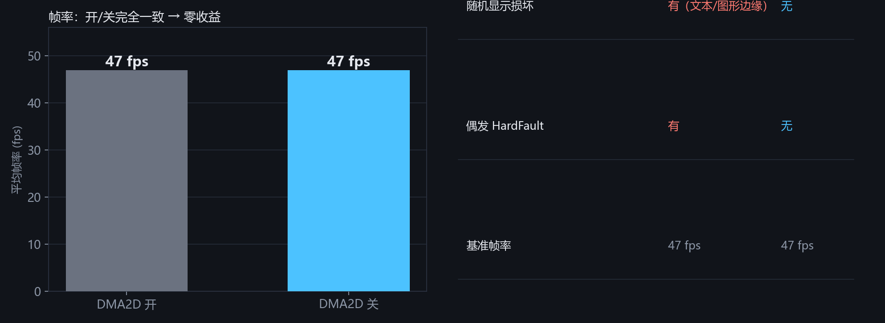
</p>

做法是**单变量判别实验**：只把 `LV_USE_DRAW_DMA2D` 置 0（纯软件渲染）——结果**帧率一点没变（仍 47 fps）**，
但随机显示损坏与偶发 HardFault **全部消失**。再确认"不是本地改动引入"（本项目对 DMA2D 唯一的改动在未启用的中断路径内），
最终定位到 **LVGL 9.5 上游两个 open bug**（缓存刷新缺失 + 同步派发顺序）。
我也把上游补丁移植回来验证过（正确但只有 45 fps，串行化代价），异步模式则连续崩溃两次 —— 于是选择"**52 fps 无风险**"。

### 5.3 系统级：P1 撕裂是两个机理，不是一个

| 现象 | 根因 | 修法 |
|---|---|---|
| **水平位移撕裂** | DVFS 改 HCLK ⇒ SDCLK 变，而 **SDRAM 刷新计数写死 1855** ⇒ 低档时间隔 58 µs ≫ 要求的 15.6 µs | 按 HCLK 闭式重算 `COUNT` 并注册调频回调 |
| **成串随机撕裂 + 时间跳 26:10** | 低 SDCLK 大摆幅下 **FMC 读采样相位失配**（+ APB4/RTC 瞬态读回） | 禁最深省电档（不进 HSI） |

用**一个单变量实验把两者切开**：只修刷新 ⇒ 位移撕裂好了、另一种还在 ⇒ 证明是两个机理。
另外实测否掉了"换时钟源让 SDCLK 恒定"这条看起来最优雅的路 —— 它引入 AXI↔FMC **跨时钟域**，芯片不开放相位调节。

### 5.4 存储：三个只有撞过才知道的物理约束

- **SD 的 DMA 中转缓冲必须落 AXI 专用段**：落 D2 SRAM 会触发 AHB 错误 `IDMATE` ⇒ FATFS 挂载后**首读必失败**。
- **SPI Flash 的读必须在一个 CS 窗口内一次全双工完成**：拆成两条 HAL 传输会在段间破坏配置，命中 erratum 窗口，**低频时更严重**。
- **写后编程忙 / 迟到完成**：wait/重试策略要按介质调；顺手把 ST 勘误 ES0392 §2.8.3 **判定为不适用**（前提不成立），避免把真错误当"已知问题"放过。

### 5.5 栈深度：一份被**三重证伪**的静态分析

第一版静态栈深报告说 GUI 任务"最坏 1968 B"，而**实测高水位已经用了 7200 B** —— **最坏值比实测小，物理上不可能**。
查下去是三类系统性缺陷：把 `assert` 死亡打印路径当稳态、分析了被 `--gc-sections` 回收的死代码、
以及调用图**在函数指针处停止遍历**（表驱动派发根本走不进去）。
结论：对这类任务，**静态"上界"不可得，只能以实测为准**；判据改成"三口径并列 + 实测高水位"。

### 5.6 可靠性：能自愈的触摸总线

长时间运行后触摸偶发失效。gdb 现场显示 `SCL` 恒为 0、`I2C2 CR2` 残留未完成传输，而软件状态全是 `READY`
—— 是**物理总线被从机拉死**。修法是定时器检测 + **bit-bang 打 9 个时钟 + STOP** + 外设 DeInit/ReInit + DMA 重挂链，
形成兜底自愈。

---

## 6. 关键数据

| 指标 | 值 | 备注 |
|---|---|---|
| 平均帧率 / 帧耗时 | **52 fps / 11 ms** | 优化前 42 fps / 21 ms |
| 空场景 | **62 fps**（= 面板刷新率上限） | flush 0 ms |
| **真机屏幕 OSD 实测** | **Home 页 `62 FPS / 19% CPU / 2 ms`**；控制中心展开 `56 FPS / 32% CPU / 15 ms` | 见 [§4.1 真机实拍](#41-真机实拍2026-11-13)，屏幕上自带计数器 |
| 渲染热链 ITCM 收益 | 帧耗时 **−29%** | 21 → 15 ms |
| 代码规模 | **455 次提交**，约 2 个月 20 天 | 全程小步提交 |
| 视觉资产 | 800×480 双层，三缓冲 **3×768 KB** SDRAM | 无撕裂 |
| 电池/功耗档 | DVFS 480/400/280/200 MHz 四档 | 有下限保护 |
| OTA 端到端 | 自动下载 → staging → 切槽，失败回跳 | 实测 A↔B 双向成功 |

---

## 7. OTA 链路（最有代表性的一条）

```
云端 MQTT(TLS) 推送触发（含镜像 URL + sha256）
        │
        ▼
ESP32-C6 收到 → 转成 0x20 命令给 STM32
        │
        ▼
STM32 自算"目标槽"（当前跑 A 就写 B），下发 0x07 让 C6 走 HTTP Range 下载
        │
        ▼
C6 分块回传 0x08 → STM32 边收边写 SD（断点续传 acked）
        │
        ▼
收完 → 擦 staging → 写 SPI Flash → 自校验 → 写 boot 配置 → 重启
        │
        ▼
bootloader：staging READY → 校验（CRC/SHA）→ 擦目标槽 → 流式写入 → 回读比对
        │             ├─ 通过 → 切 active_slot → 启动新固件 → confirm
        │             └─ 不通过 → readback DENY → 回跳原槽（不变砖）
```

**踩过的两个真问题**（都写进了设计）：

1. **"全链成功却失败"**：bootloader 的 SPI 源读会偶发返回整块 `0x00`，坏值被原样写进 QSPI 目标槽。
   修法 = 有界重读 + 先擦本窗再写 + 源头加固；判据是"`0x00` 只能被写进去、不可能被擦出来"。
2. **契约版本分界**：staging 布局从"固定基址"改成"容量无关"（`flash_size − 0x402000`）后，
   旧固件与新 bootloader 不兼容 ⇒ 定 `0x010500` 版本分界，旧固件只允许 SWD 直刷（**刻意的代价，不是 bug**）。

---

## 8. 工程化与验证

做一个人项目最容易垮掉的不是代码，是**验证与追溯**。这个项目在两侧都做了投入：

| 环节 | 做法 |
|---|---|
| **构建** | CMake + Ninja，`Debug` / `RelWithDebInfo` / 仿真档三配置；改动必须双配置编译 |
| **CI** | GitHub Actions 三配置构建 + **"模拟器宏泄漏"守卫**（生产 `.c` 里出现模拟器专用宏即红） |
| **仿真** | **Renode** 双仓验证：启动 sentinel、驱动链路、SPI Flash 模型、FrameDump 导出 UI 帧（本文 3 张界面图即出自这里） |
| **真机** | 串口 S/F/W/E 分级日志 + 可编程观测量（1 MHz 时基量 vblank 间隔、逐帧欠压计数、DMA 状态机快照） |
| **主机侧** | 把可移植模块（demux/VFS 队列/文件系统路由）做成**主机可测夹具**，用 ctest 跑 |
| **协作** | 自己搭的串口 MCP（SerialHub）+ 项目记忆库（71 条编号事实、72 个会话块，每条都带提交哈希），保证"每个结论都能回溯" |

<p align="center">
  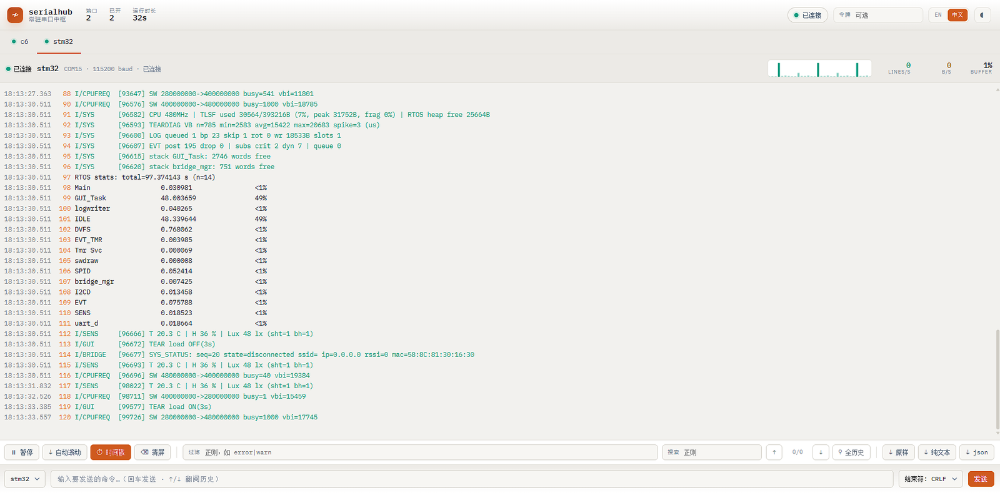
  &nbsp;
  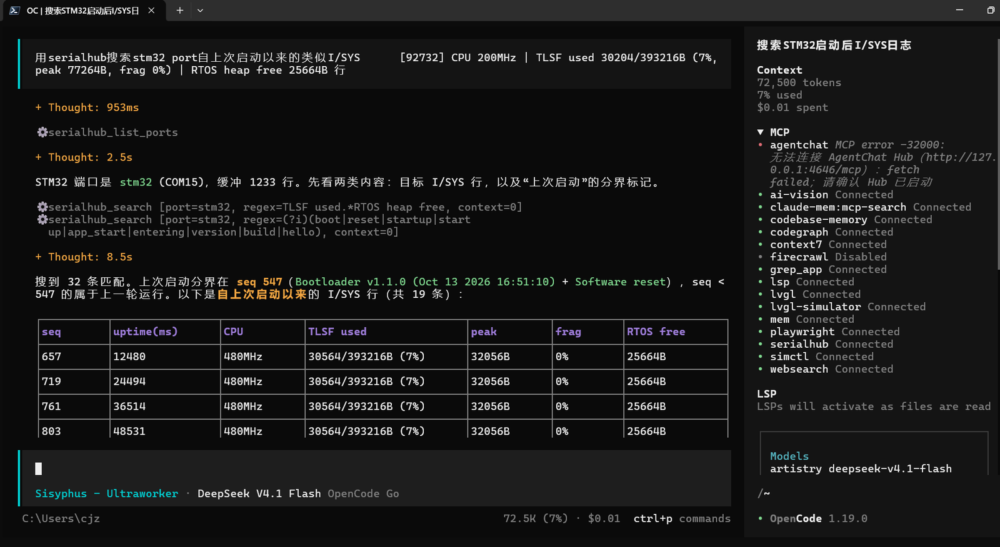
</p>

---

## 9. 开发时间线

<p align="center">
  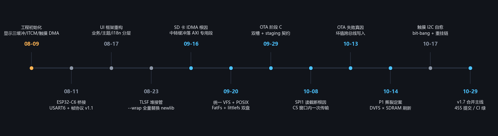
</p>

---

## 10. 仓库导航

| 文件 | 内容 |
|---|---|
| [`docs/architecture.md`](docs/architecture.md) | 分层、职责边界、接口契约、内存/缓存约定 |
| [`docs/hardware.md`](docs/hardware.md) | 硬件清单、引脚与时钟树、外设分配 |
| [`docs/highlights.md`](docs/highlights.md) | 技术亮点详版（含判据、量化、被否证的方案） |
| [`docs/ota.md`](docs/ota.md) | OTA 契约、状态机、失败处置 |
| [`docs/ai-collaboration.md`](docs/ai-collaboration.md) | 与 AI 协作的工程方法（含"AI 出错被纠正"的实例） |
| [`scripts/`](scripts/) | 本文图片与图表的生成脚本（可复现） |

---

## 11. 许可与第三方

- 本项目为**个人作品**，用于求职展示；**源码未公开**。如需评估代码请联系我。
- 本项目使用的第三方组件（LVGL / FreeRTOS / FatFs / littlefs / TLSF / EasyLogger / STM32 HAL 等）遵循各自的原有许可；
  **本展示仓不包含任何第三方源码**。
- ⚠ 本项目中的 OTA 服务端使用**自签证书**、演示环境**关闭了部分安全校验**，
  仅用于实验，**不可直接用于生产**（发布者鉴别尚未实施）。

---

<p align="center"><sub>Built with STM32H750 + FreeRTOS + LVGL · 2026</sub></p>
