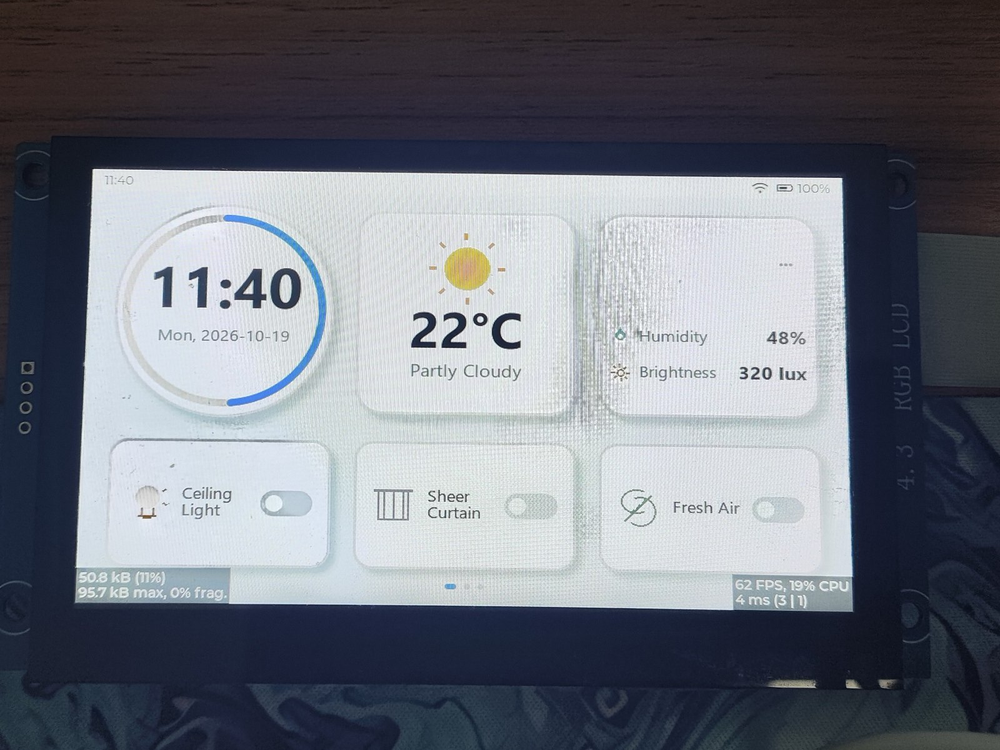
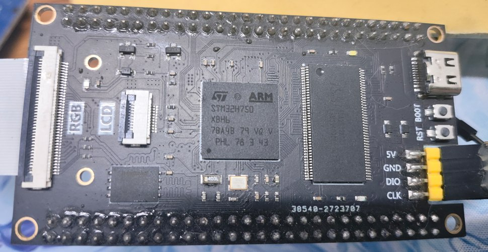
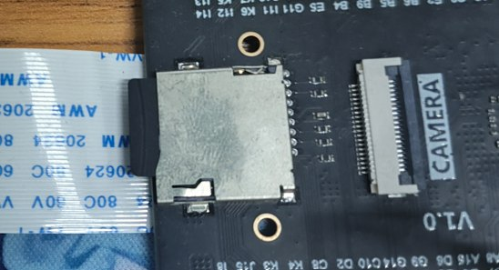
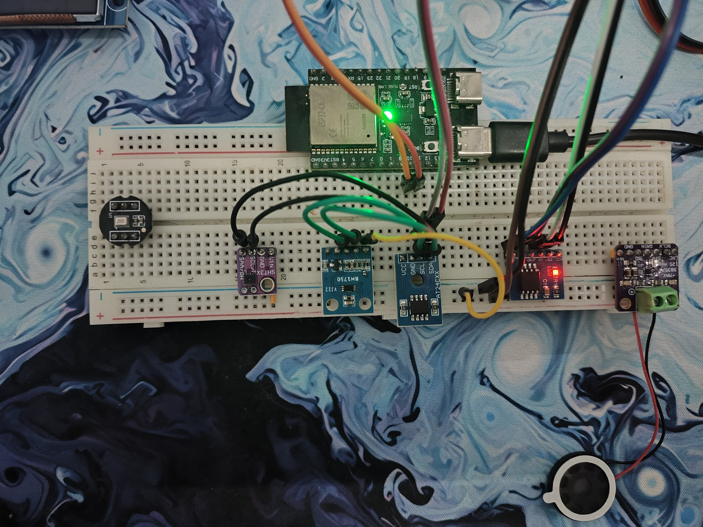

# 硬件清单与时钟/外设分配

> 以主项目 `agent/INTERFACES.md`、`agent/PROJECT_FRAMEWORK.md`、`Core/Src/main.c`、`boot.ioc` 为准；本页为展示用摘要。

## 0. MCU 型号确认（**以 CubeMX 工程文件为准**）

❌ **常见错误写法**：`STM32H750VBT6 / LQFP100`（我早期文档也这么写过，已纠正）。
✅ **正确型号**：以 CubeMX 工程文件 `boot.ioc` 的权威字段为准 ——

```
Mcu.CPN                        = STM32H750XBH6
Mcu.Name / Mcu.UserName        = STM32H750XBHx
Mcu.Package                    = TFBGA240
ProjectManager.DeviceId        = STM32H750XBHx
ProjectManager.FirmwarePackage = STM32Cube FW_H7 V1.13.0
```

⇒ 真实芯片是 **STM32H750XBH6**（240 球 TFBGA，128 KB 片内 Flash）。

**两条独立判据**（不只靠工程文件）：

1. **引脚证据**：I2C2 的 SCL 用的是 **`PH4`**（触摸总线卡死排查时用 gdb 读到该引脚恒为 0），
   而 **PH 端口在 LQFP100 封装上不可用** ⇒ 封装必然更大。
   主项目 `agent/OTA_PLAN.md` 也把"引脚含 PI/PJ/PK/PF/PG/PH（LQFP100 不具备）"写成过判据。
2. **工程证据**：CubeMX 生成的 `.ioc` 里 `Mcu.Package=TFBGA240`，且 `Mcu.CPN` 直接给出完整订货号。

> **教训**：型号这类"元信息"最容易被复制粘贴传播——一旦错一次，后面所有文档都会跟着错。
> 所以正确的做法是**只认工程文件里的 `Mcu.CPN`**，并且用**引脚能力**做交叉验证。

## 1. 主控与存储

| 项 | 型号 / 规格 | 关键点 |
|---|---|---|
| MCU | **STM32H750XBH6**（Cortex-M7 @ 480 MHz，**TFBGA240** 封装，128 KB 片内 Flash） | 片内 Flash 只放启动；应用代码在外部 QSPI（XIP）。型号确认见 §0 |
| 内部 RAM | ITCM 64 KB / DTCM 128 KB / AXI SRAM 512 KB / D2 SRAM 288 KB | 分层使用（见 §4） |
| 外部 QSPI Flash | **W25Q256**（32 MB） | App **双槽**：slot A / slot B；映射于 `0x90000000`（XIP） |
| SPI Flash | **W25Q128**（16 MB）/ 可换 **W25Q64**（8 MB） | `S:` 文件系统 + **OTA staging**（布局容量无关） |
| SDRAM | **32 MB**（FMC，`0xC0000000`） | 帧缓冲 `.sdram_fb`、大块数据 |
| SD 卡 | SDMMC1 | `U:` 文件系统（FAT），支持 31 GB / 4 GB 两种几何 |

> **为什么代码要放外部 QSPI**：128 KB 片内 Flash 装不下 LVGL + 应用；QSPI XIP + I-Cache 后性能可接受。
> **代价**：启动与取指依赖 QSPI 时钟 —— 这也是"改某个外设时钟时顺手把 PLL2 关停"会直接打崩程序的原因
> （PLL2 是 QSPI 的时钟源，关停窗口内取指失败 ⇒ HardFault PC=0）。

## 2. 显示与触摸

| 项 | 规格 | 关键点 |
|---|---|---|
| 面板 | **800×480 RGB LCD** | LTDC 双层输出 |
| LTDC | 2 层：**L1 底层 / L2 = LVGL UI 层** | 三缓冲 + **CFBAR 影子寄存器**在垂直消隐期换页 |
| 像素时钟 | LTDC 内核时钟 = **PLL3R ≈ 33.33 MHz** | 与 CPU 调频（PLL1）解耦 ⇒ DVFS 不改像素时钟 |
| 触摸 | **GT1158**（I2C2） | **TIM7 16 ms + I2C2 DMA** 后台采样，不阻塞 GUI 任务 |
| 背光 | PWM（TIM12） | 亮度可调 + 掉电记忆 |

## 3. 联网与传感器

| 项 | 型号 | 接口 | 关键点 |
|---|---|---|---|
| 协处理器 | **ESP32-C6**（N16，16 MB Flash，无外挂 PSRAM） | **USART6**（`PC6/PC7`，921600） | WiFi/MQTT/TLS/HTTP Range 全在 C6；STM32 只发命令码 |
| 温湿度 | **SHT3x** | I2C | 周期采样 |
| 光照 | **BH1750** | I2C | 用于自动亮度 |
| 参数存储 | **AT24Cxx** EEPROM | I2C | 键值分区（避开自检块与 OTA NVM 区） |
| RTC | LSE 外部晶振 | — | 时间保持 + 校时链路 |

## 4. 内存分配（**这是本项目最讲究的一块**）

| 区域 | 放什么 | 为什么 |
|---|---|---|
| **ITCM 64 KB** | 高频 ISR + LVGL 渲染热链（`itcm_fast_isr.ld`） | 零等待取指，**实测帧耗时 −29%** |
| **DTCM 128 KB** | 任务栈、FreeRTOS `heap_4`（80 KB）、FS 线程栈 | 低延迟、不进总线矩阵 |
| **AXI SRAM 512 KB** | **TLSF 池**（经 `--wrap` 接管 `malloc/free` 等 + newlib 重入版） | 统一堆，替换 newlib 碎堆；DMA 缓冲用专用段 |
| **D2 SRAM 288 KB** | 触摸 DMA 缓冲、通用 DMA 缓冲 | MPU 配为**非缓存**，DMA 直达 |
| **SDRAM 32 MB** | `.sdram_fb` 三缓冲（3×768 KB）、大块数据 | 可缓存（WB）+ 显式清理；LTDC 从这里取数 |

**两条硬规则**（都是踩过坑之后立的）：

1. **凡 DMA 目标不进可缓存区**。否则必须逐点 `Clean/Invalidate`，漏一处就出现"偶发数据错"。
2. **FMC/SDRAM 是固定时序总线**：DVFS 改 HCLK ⇒ SDCLK 变，**刷新计数必须跟着重算**，否则刷新间隔会被拉长到几倍
   （实测低档 58 µs ≫ 要求 15.6 µs）⇒ 帧缓冲位错 ⇒ 画面撕裂。

## 5. 时钟树要点

- CPU 侧 `PLL1` 参与 DVFS（480/400/280/200 MHz 四档），有**下限保护**（不进最深省电档）。
- **显示/外设与 CPU 调频解耦**：LTDC = PLL3R、I2C2 = PLL3、SDMMC = PLL2R、QSPI = PLL2。
- 只有 **FMC/SDRAM** 不能解耦（时钟源跟着 HCLK），所以它需要"调频后重算刷新率"的专门处理。
- **CPUFREQ 通知机制**：`cpufreq_register_notify(BEFORE/AFTER, cb)`（8 槽，关中断上下文、非阻塞），
  触摸采样定时器与背光 PWM 都注册了 AFTER 回调，按实际 APB 分频重算 PSC ⇒ 采样周期与 PWM 频率全档位恒定。

## 6. 硬件照片

<p align="center">
  
</p>

<p align="center">
  
  &nbsp;
  
</p>

<p align="center">
  
</p>
