# 作品集（17 页幻灯片）

> 求职用的项目作品集，覆盖：项目总览 → 系统架构 → 硬件与技术栈 → **6 个技术亮点** → UI 与交互 →
> 3 个附属项目 → 工程方法与验证 → 成果与收获。

## 下载

| 格式 | 文件 | 大小 | 说明 |
|---|---|---|---|
| **PDF** | [`portfolio-STM32H750.pdf`](../assets/portfolio-STM32H750.pdf) | 0.78 MB | **推荐**：排版固定、跨平台、浏览器可直接看 |
| **PowerPoint** | [`portfolio-STM32H750.pptx`](../assets/portfolio-STM32H750.pptx) | 2.46 MB | 可编辑原件（16:9，17 页） |

> ⚠ **公开版已对第 1 页的联系方式做掩码处理**（`193****2002`）。
>
> 下面的逐页预览由 PDF 渲染生成（1440×810），与原件排版一致；生成脚本见
> [`scripts/build_portfolio.py`](../scripts/build_portfolio.py)（pptx → PDF → PNG，可复现）。

---

## 逐页预览

| **P1** 封面 · STM32H750 智能家居终端 | **P2** 项目总览 |
|---|---|
| 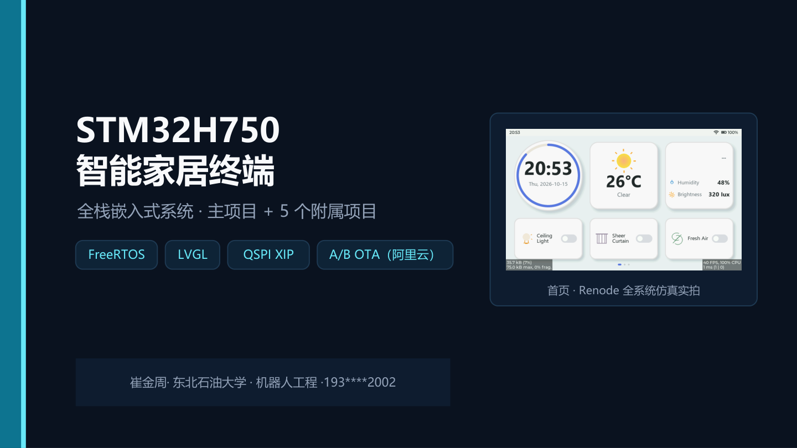 | 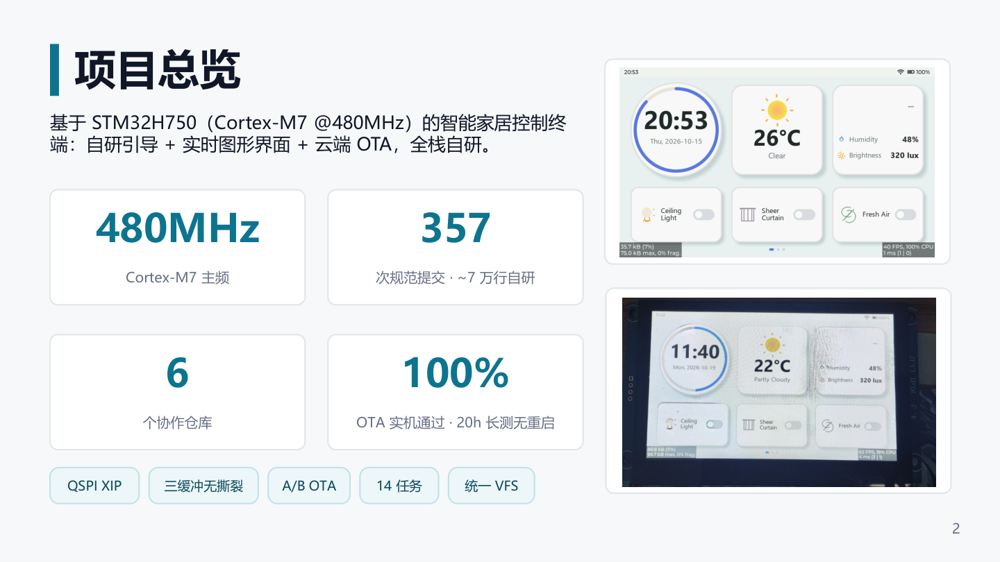 |
| **P3** 系统架构全景（7 层 + 启动链） | **P4** 硬件平台 & 技术栈 |
| 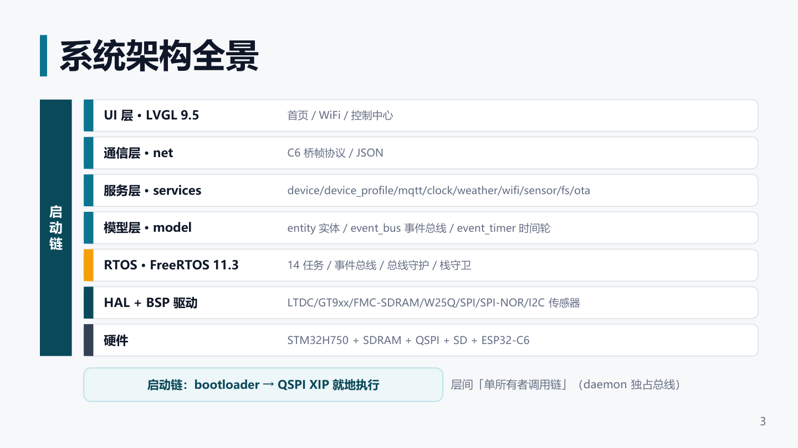 | 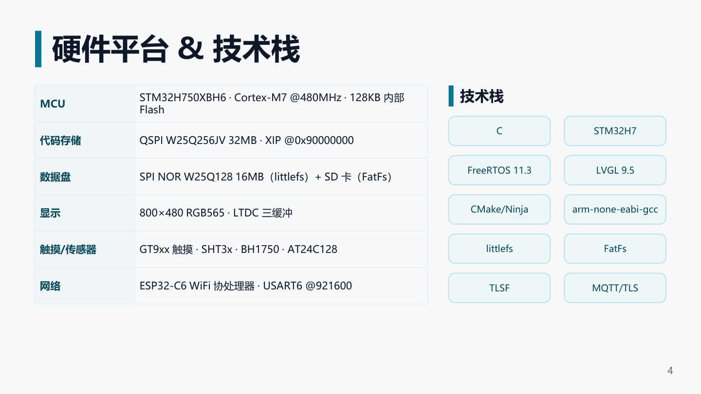 |
| **P5** 亮点 ① | **P6** 亮点 ② |
| 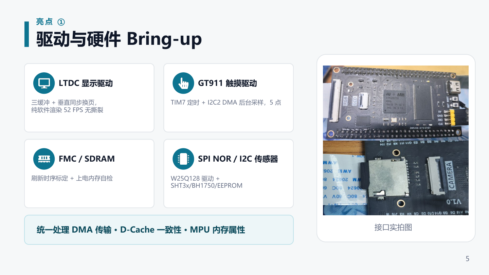 | 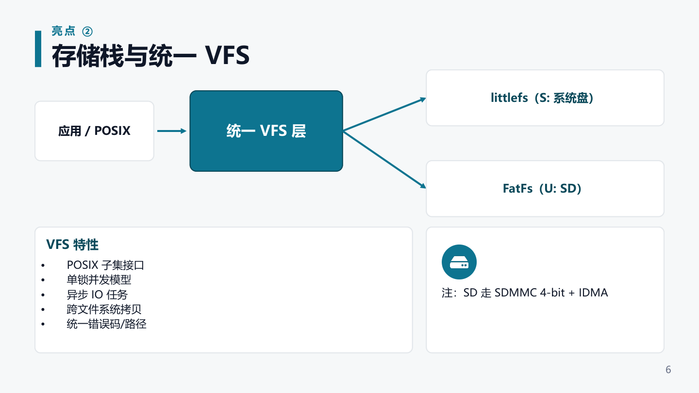 |
| **P7** 亮点 ③ | **P8** 亮点 ④ |
| 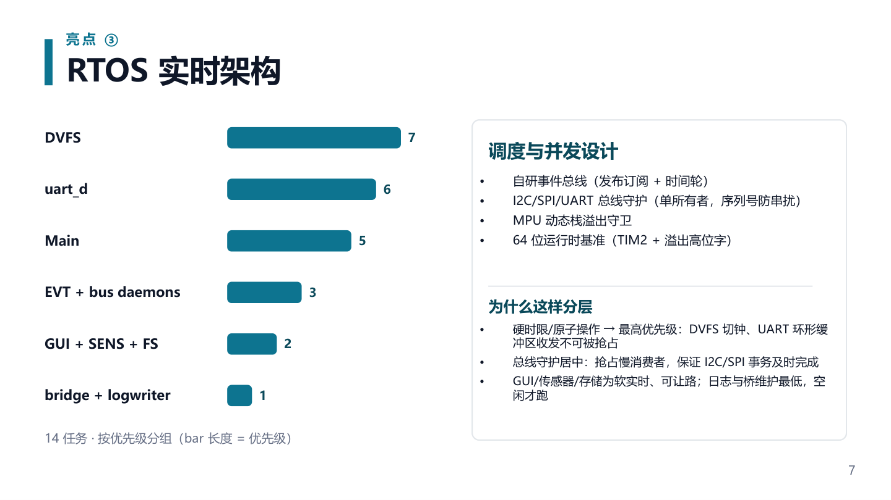 | 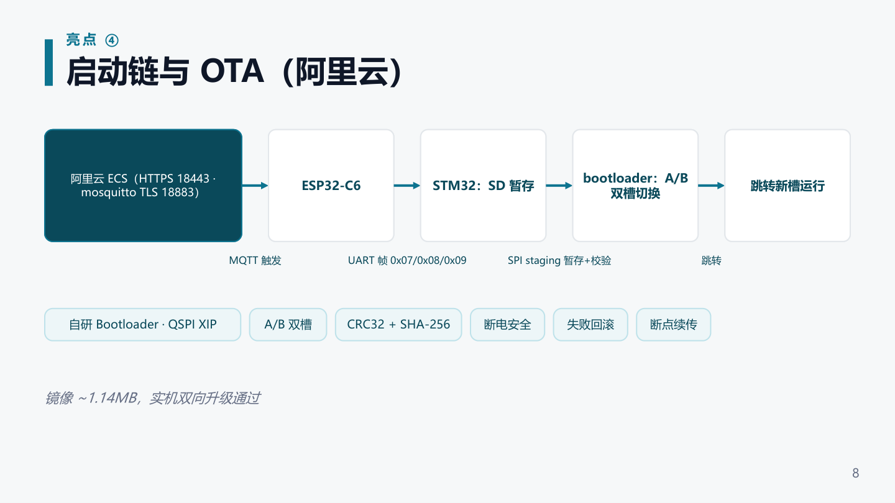 |
| **P9** 亮点 ⑤ | **P10** 亮点 ⑥ |
| 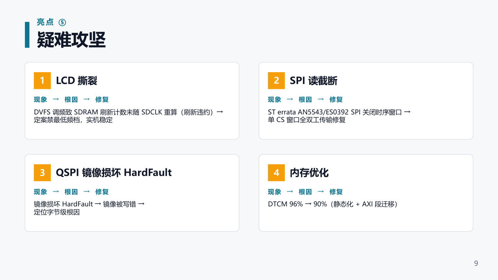 | 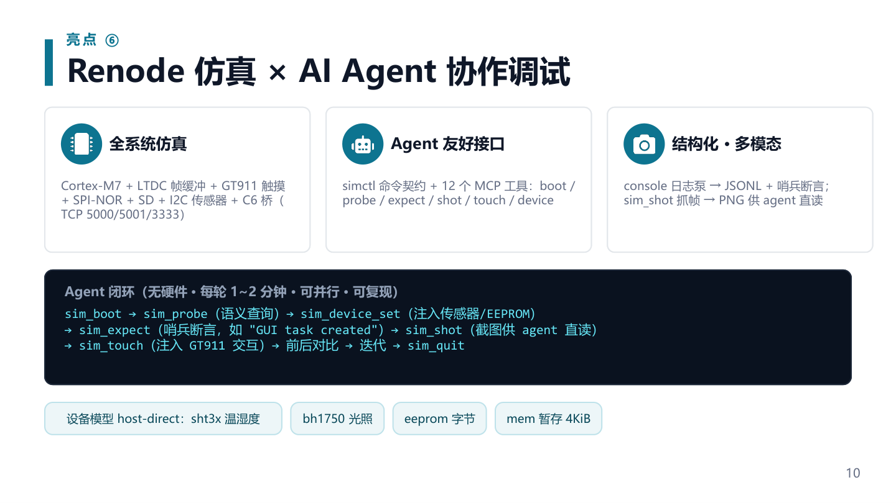 |
| **P11** 亮点 ⑥（续） | **P12** UI 与交互 |
| 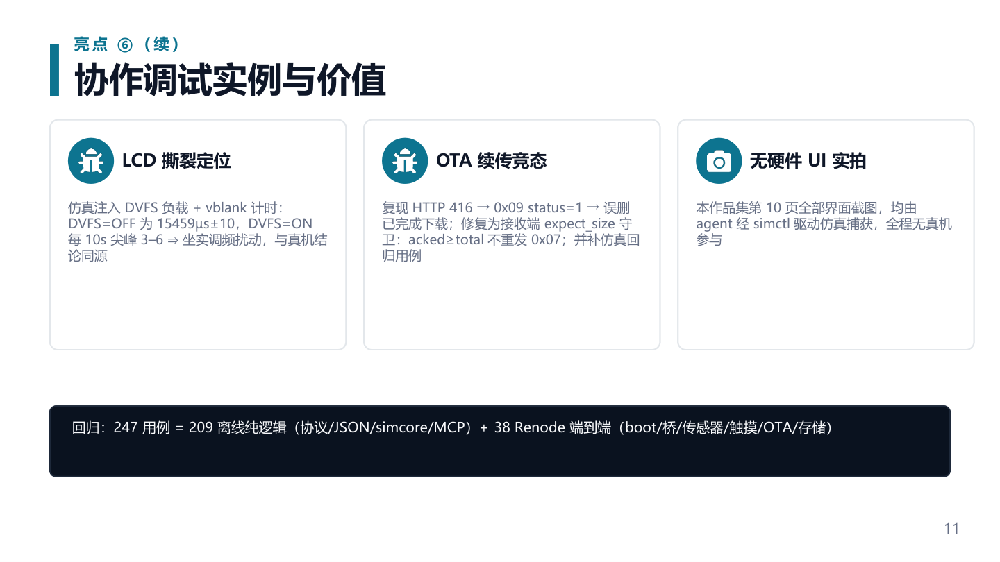 | 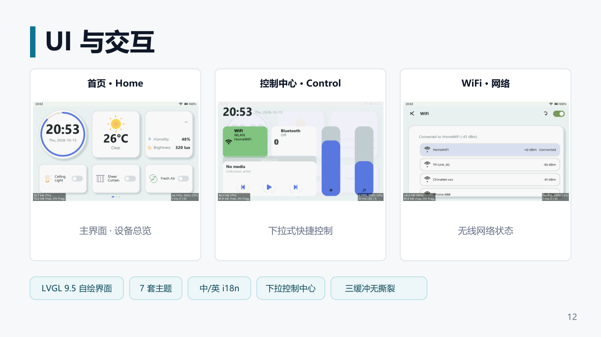 |
| **P13** 附属项目 ① | **P14** 附属项目 ② |
| 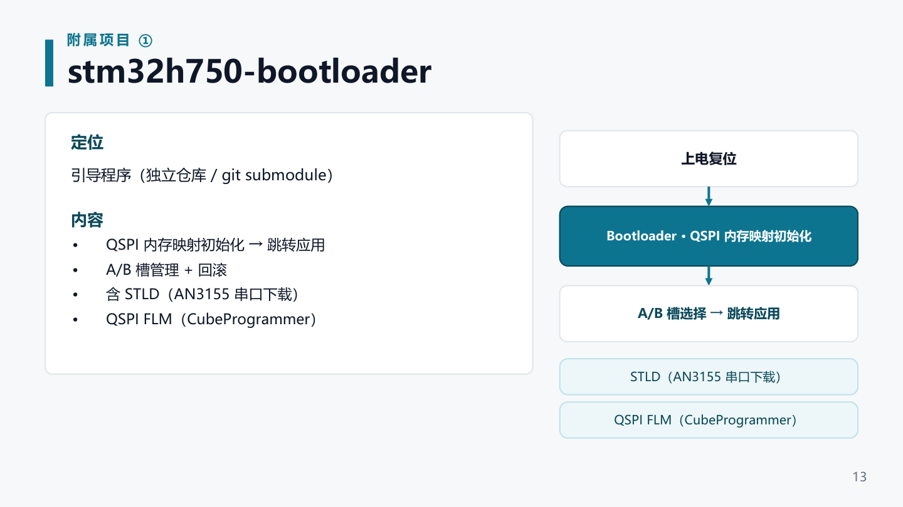 | 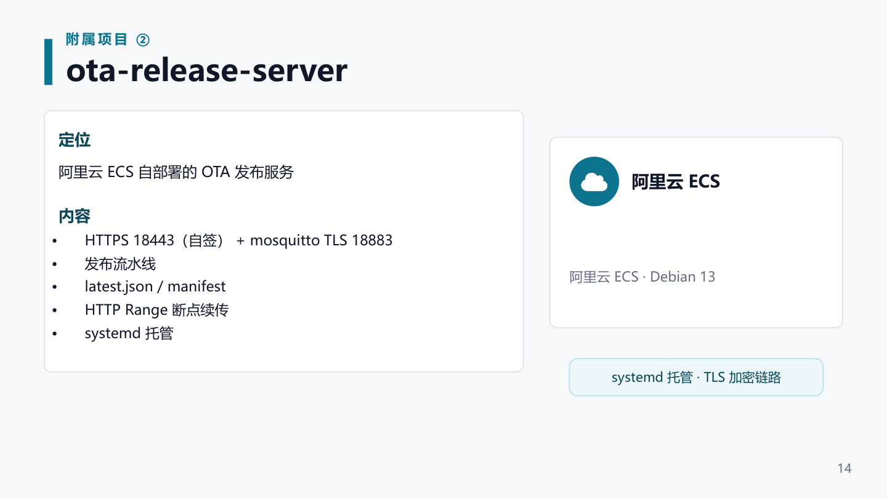 |
| **P15** 附属项目 ③ | **P16** 工程方法与验证 |
| 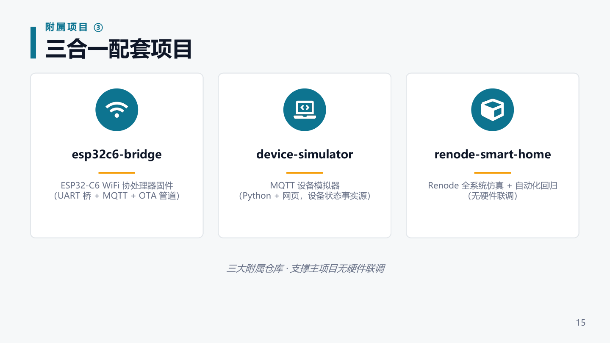 | 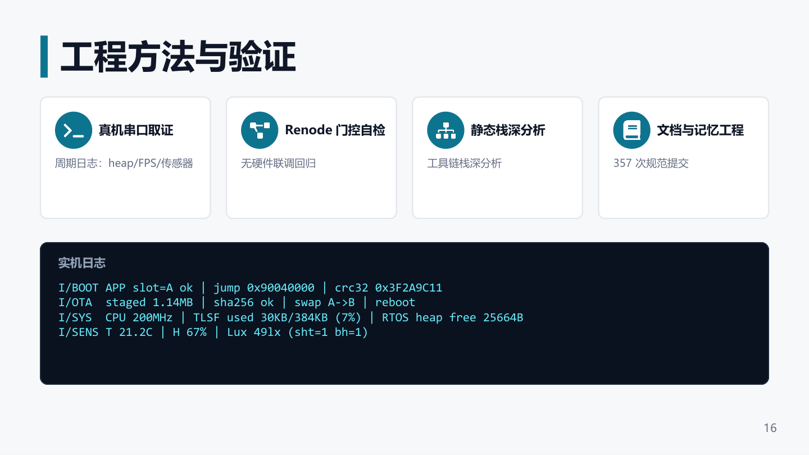 |
| **P17** 成果与收获 | |
| 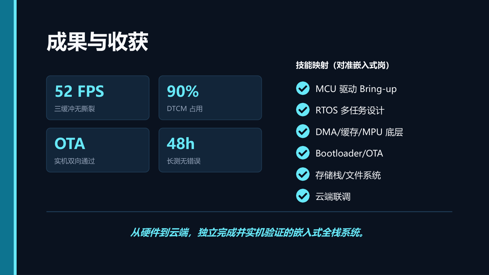 | |

---

## 与文档的对应关系

| 幻灯片主题 | 对应文档 |
|---|---|
| P3 系统架构全景 | [`architecture.md`](architecture.md) |
| P4 硬件平台 & 技术栈 | [`hardware.md`](hardware.md) |
| P5–P11 技术亮点 | [`highlights.md`](highlights.md) |
| P16 工程方法与验证 | [`ai-collaboration.md`](ai-collaboration.md) · [`ota.md`](ota.md) |
